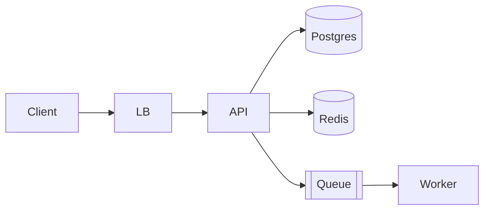

# Design Doc: [اسم الـ feature / النظام]

- **الكاتب:** _____ · **التاريخ:** YYYY-MM-DD · **الحالة:** Draft | In review | Approved | Implemented
- **المراجعين:** _____
- **الـ ADRs المرتبطة:** _____

## TL;DR (3 سطور)

إيه اللي هنبنيه، ليه، وإيه القرار الأهم فيه.

## 1. المشكلة والسياق

- المشكلة (من منظور المستخدم/البيزنس): _____
- ليه دلوقتي: _____
- الوضع الحالي وإيه اللي ناقص: _____

## 2. الأهداف و غير الأهداف

**Goals:**
- _____

**Non-goals (صراحةً مش هنعمله):**
- _____

## 3. المتطلبات

**Functional:** _____

**Non-functional (بأرقام):** latency p95 _____ · throughput _____ · availability _____ · consistency _____ · data size _____

## 4. Estimation (back-of-the-envelope)

- Users / QPS (avg و peak): _____
- Storage (سنة): _____
- Bandwidth: _____
- Cache size (80/20): _____

## 5. الخيارات

| | الخيار A | الخيار B | الخيار C |
| --- | --- | --- | --- |
| الوصف | | | |
| Complexity | | | |
| Performance | | | |
| Cost | | | |
| Risk | | | |
| **القرار** | | ✅ | |

ليه B: _____

## 6. التصميم المقترح

### 6.1 High-level (diagram)



### 6.2 Data model

```sql
-- الجداول / الأعمدة / الـ indexes المهمة وليه
```

### 6.3 API

```
POST /api/v1/...   → request/response shape، status codes، idempotency
```

### 6.4 Flow الرئيسي (sequence)

```mermaid
sequenceDiagram
  Client->>API: POST /orders (Idempotency-Key)
  API->>DB: BEGIN; insert order; insert outbox; COMMIT
  API-->>Client: 201
  Relay->>Queue: publish OrderPlaced
```

### 6.5 Deep dive على الجزء الحرج

الجزء اللي هيكسر الأول: _____ — وإزاي اتعاملنا معاه.

## 7. Failure modes و Resilience

| إيه اللي ممكن يقع | الأثر | إزاي بنتعامل |
| --- | --- | --- |
| DB down | | |
| Queue lag | | |
| External API slow | | timeout + circuit breaker + fallback |
| Duplicate request | | idempotency key |

## 8. Security و Privacy

- AuthN/AuthZ: _____ · Tenant isolation: _____ · PII: _____ · Threats (STRIDE مختصر): _____

## 9. Observability

- Metrics (RED): _____ · Traces: _____ · Logs: _____ · SLO: _____ · Alerts: _____

## 10. "إيه اللي هيكسر الأول لو الحمل ×10؟"

_____ → وخطة التطور: _____

## 11. Rollout plan

- Migration (expand/contract): _____
- Feature flag: _____
- Canary → 100%: _____
- Rollback: _____

## 12. Cost estimate

~$_____/شهر عند الـ scale المستهدف (compute _____ + DB _____ + egress _____)

## 13. Open questions

- [ ] _____

## 14. Timeline / Milestones

| Milestone | إيه اللي بيتسلّم شغال | التقدير |
| --- | --- | --- |
| M1 | | |
